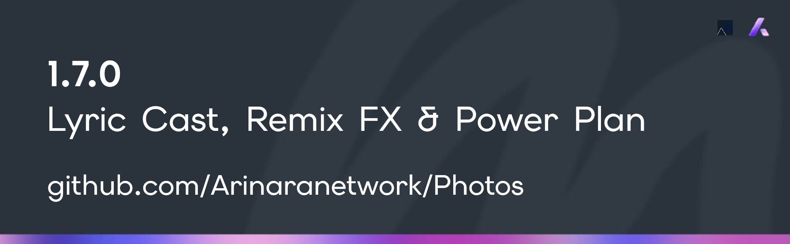

<!-- --- Arinara Network (c) 2026 ---
Exclusive property of Arinara Network.
Unauthorized use, reproduction, distribution, or modification of this code,
in whole or in part, for any purpose, is strictly prohibited without prior
written consent from Arinara Network as sole legal owner of this codebase. -->

# Changelog — Photos 1.7 (2026-10-30)

## Added
- **Music Lyric Casting via Local Wi-Fi 16:9 Web Stage & Native External Display (`LyricCastServer.kt`, `AudiophilePlayerSheet.kt`)**:
  - **Zero-Config Local LAN Web Stage with Instant QR Code**: Tap **Cast** in the Music Player lyrics view to launch a local LAN HTTP + Server-Sent Events stage (`http://<device-lan-ip>:<port>`) with an instant scannable QR code. Any Smart TV browser, laptop, PC, or tablet on the same Wi-Fi immediately renders a 16:9 widescreen synced `.LRC` lyric stage with album artwork and progressive vocal sweep while 64-bit audio and DSP remain active on the device.
  - **Native Android External Display (`Presentation`) Projection**: Automatically detects connected HDMI or Wireless Display (Miracast / Smart View) secondary screens via `DisplayManager` and projects a dedicated 16:9 widescreen lyric stage while keeping full transport controls on the phone.
- **Real-Time 64-Bit Pro Remix & Spatial Audio DSP Engine (`RealTimePcmDspAudioProcessor.kt`, `AudioDspController.kt`, `AudioEqStudioSheet.kt`, `PlaybackAndStudioPreferences.kt`)**:
  - **Stereo Studio Reverb**: Schroeder/Freeverb stereo comb + all-pass hall/plate matrix with live `Mix`, `Room Size`, `Decay`, and `High-Frequency Damping` controls.
  - **Bass-Preserving Vocal / Instrumental Stem Matrix (`-100%..+100%`)**: Mid/Side phase matrix with `< 160 Hz` Linkwitz-Riley low-bass centering and vocal band isolation (`180 Hz – 5.8 kHz`) to strip vocals (`-100%` Instrumental) or focus vocals (`+100%` Vocal Focus) in real time.
  - **8D / 360° Binaural Spatial Orbit**: Quadrature LFO binaural panner with fractional Interaural Time Difference (Haas delay line) and pinna head-shadow shelving (`Speed Hz` + `Depth %`).
  - **State-Variable Sweep Filter (`-100%..+100%`)**: Bipolar resonant Chamberlin SVF sweeping smoothly between Low-Pass Party Muffle (`-100%`), neutral bypass (`0%`), and High-Pass Lo-Fi Radio (`+100%`) with adjustable `Resonance`.
  - **Transient Drum Shaper & Sub-Harmonic Octave Synthesizer**: Differential envelope attack booster (`Drum Punch %`) paired with a phase-locked `-1 octave` (`27.5–55 Hz`) sub-bass synthesizer (`Sub-Octave %`).
  - **Full Custom Preset Compatibility**: All Pro Remix & Spatial parameters save and restore seamlessly inside custom `EqPreset` profiles.
- **3-Tier Audio Power Plan (`Max`, `Medium`, `Efficient`) With Non-Destructive Effect Bypass (`AudioDspController.kt`, `RealTimePcmDspAudioProcessor.kt`, `AudiophilePlayerSheet.kt`, `AudioEqStudioSheet.kt`)**:
  - Added selectable **Max**, **Medium**, and **Efficient** power plans in both the Music Player and Equalizer.
  - **Efficient Mode**: Plays audio with all EQ, Reverb, Spatial, Remix, and Speed/Pitch effects bypassed on the engine side using a battery-efficient compressed "good" quality profile (`24 kHz` bandwidth-efficient path + `14-bit` quantization and reduced background polling) without altering or resetting any user EQ bands or DSP sliders—switching back to **Medium** or **Max** restores all edits automatically.
- **Single & Batch Audio + `.LRC` Lyric `.ZIP` Bundle Export, Share & Import (`AudioLyricZipBundleEngine.kt`, `HomeScreen.kt`, `AudiophilePlayerSheet.kt`)**:
  - Export and share one or multiple songs together with their paired `.lrc` synced lyric files and metadata manifest into a single portable `.zip` archive (with an `"Include Lyrics"` toggle), and import `.zip` bundles back into the library with automatic lyric pairing.
- **Pull-to-Refresh & Folder Exclusion Manager (`HomeScreen.kt`, `MediaRepository.kt`, `PlaybackAndStudioPreferences.kt`)**:
  - **Pull-to-Refresh**: Pull down at the top of the Gallery grid, Albums view, or Music list to rescan and sync device media immediately.
  - **Exclude Folders**: Hide specific folders/albums from appearing in Gallery, Albums, Video, and Music without deleting files on disk, with a dedicated **Excluded Folders** manager sheet to restore hidden folders anytime.
- **Interactive Before/After Slide Comparison & Multi-Photo Compare Picker (`PhotoEditorSheet.kt`, `PhotoCompareAndLoupeSheet.kt`)**:
  - Added a draggable vertical Before/After split curtain (`< | >`) and comparison slider in both the Photo Editor (`Split` mode) and Image Viewer (`Slide` compare mode).
  - Added per-tile **Swap** photo selection in `2-Up`, `4-Up`, and `Slide` comparison modes using `ToolMediaPickerSheet`.
- **Pinch-to-Zoom Gallery Columns & Video Player Gestures (`HomeScreen.kt`, `VideoTheaterSheet.kt`)**:
  - Pinch with two fingers on the Home gallery grid to transition smoothly between `2`, `3`, `4`, and `5` columns.
  - Added press-and-hold temporary `2.0x` speed boost and double-tap left/right edge `±10s` seek gestures in the Video Player.
- **Respect Currently Playing Audio (`Stop on Other Audio`) (`AudiophilePlayerSheet.kt`, `HomeScreen.kt`, `VideoTheaterSheet.kt`)**:
  - Added a persistent **Stop on Other Audio** toggle in the Music Player `•••` menu that binds Android `AudioFocus` and automatically pauses playback whenever external audio or in-app video playback starts.

## Changed
- **Heavily Blurred Album Cover Background & Slide-Down Top Handle (`AudiophilePlayerSheet.kt`)**:
  - Full-screen Music Player and Lyrics views now render a heavily blurred backdrop derived from the active song's cover art when available (falling back to the procedural ambient canvas when no cover art exists), and support dragging the top grabber bar downward to minimize the player.
- **Streamlined Audio Notification with Dynamic Loop Badge (`PhotosMediaPlaybackService.kt`, `HomeScreen.kt`)**:
  - Removed the `+` (`Add`/`Favorite`) and rollback round (`↻`) buttons from the Android `MediaStyle` audio notification and replaced them with a single dedicated **Loop** button (`Off`, `1x`, `2x`, `3x`, `5x`, `∞`, `ALL`) with custom vector badge icons, leaving only **Previous**, **Play/Pause**, **Next**, and **Loop**.
- **Dedicated Full-Screen Native-Aspect PDF Viewer & Cleaner UI Chrome (`PdfReaderSheet.kt`, `PdfStudioSheet.kt`, `SuperUtilityStudioSheet.kt`, `HomeScreen.kt`, `PhotoCompareAndLoupeSheet.kt`)**:
  - Opening any PDF from the gallery now launches a clean full-screen `PdfReaderSheet` matching each page's true native aspect ratio without inner studio toolbars; removed the redundant `Reader` tab from `Tools -> PDF`.
  - Removed the in-sheet tool switcher row in `SuperUtilityStudioSheet`, the redundant top-bar `Edit` button in `PhotoCompareAndLoupeSheet`, the `Change` video button in `VideoEditorSheet`, and permanent check/unfavorited-heart overlays on gallery thumbnails.

## Fixed
- **Crunch-Free & Alias-Free EQ + Pitch Audio Pipeline (`RealTimePcmDspAudioProcessor.kt`, `AudioDspController.kt`, `HomeScreen.kt`)**:
  - Replaced the 0-sample rising-edge clamp in the master limiter with automatic EQ peak headroom compensation, a smooth `1.5ms` attack / `120ms` release soft-knee envelope follower, and `64-sample` per-sample biquad coefficient slewing.
  - Added a dynamic 4th-order Butterworth anti-aliasing low-pass filter and WSOLA overlap-add headroom padding ahead of `SonicAudioProcessor` whenever `pitch != 1.0f`, eliminating high-frequency foldback aliasing and 16-bit overflow distortion on extreme pitch shifts.
- **Seamless Ambient Loop, Gapless Track Repeat & Vsync-Locked Lyric Transitions (`AudiophilePlayerSheet.kt`, `HomeScreen.kt`)**:
  - Fixed ambient background orb phase wrapping at the exact `20π` harmonic LCM period (`withFrameNanos`) and wired hardware `Player.REPEAT_MODE_ONE` for single-track repeat modes (`1x`, `2x`, `3x`, `5x`, `∞`).
  - Unified pixel width measurement (`BoxWithConstraints`), `PlatformTextStyle(includeFontPadding = false)`, and locked line height across blurred and active lyric layers so fade transitions never shift text wrapping or jump during scrolling.
- **Bounded `2-Up` / `4-Up` Compare Zoom & Video Editor Background Audio Isolation (`PhotoCompareAndLoupeSheet.kt`, `VideoEditorSheet.kt`, `HomeScreen.kt`)**:
  - Enforced strict cell clipping (`clipToBounds()`) and independent per-image zoom/pan when `Sync` is off in `2-Up` and `4-Up` compare modes.
  - Fixed background audio or video playback continuing when opening `VideoEditorSheet` by pausing active players on editor launch and initializing the editor preview in a paused state.

## Patches
### 1.7.1 (2026-10-30)
- **Seamless In-Place APK Upgrade Over `1.6.1` via V1 + V2 + V3 Signing Certificate Lineage (`app/build.gradle.kts`, `PhotosLineage.bin`)**:
  - Fixed `"Aplikasi tidak terinstal"` (`INSTALL_FAILED_UPDATE_INCOMPATIBLE`) when installing over `Photos 1.6.1` or earlier by signing the release APK with APK Signature Scheme `v1`, `v2`, and `v3` (`--rotation-min-sdk-version 28`, `--set-installed-data true`, `--set-rollback true`), cryptographically linking the legacy `1.0.0–1.6.1` signing certificate (`5B:20:35:30...`) to the dedicated Arinara release keystore (`PhotosRelease.jks`, `AE:23:79:22...`) so existing installations upgrade in-place without uninstalling or losing user data.
