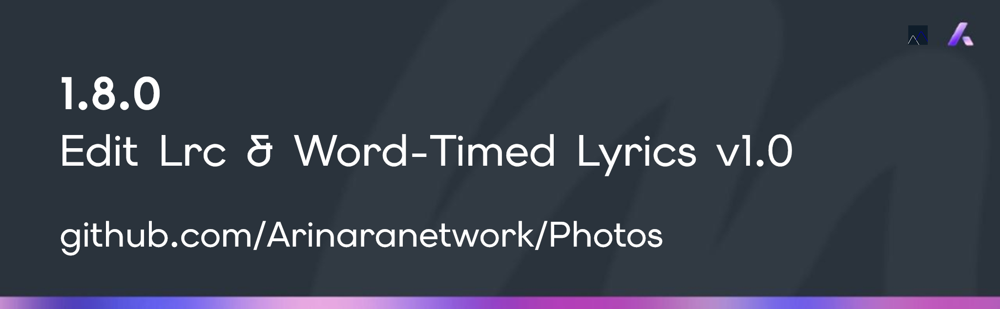

<!-- --- Arinara Network (c) 2026 ---
Exclusive property of Arinara Network.
Unauthorized use, reproduction, distribution, or modification of this code,
in whole or in part, for any purpose, is strictly prohibited without prior
written consent from Arinara Network as sole legal owner of this codebase. -->

# Changelog — Photos 1.8 (2026-11-14)

## Added
- **Word-Timed Lyric Format (`version: '1.0'`) Support (`MediaModels.kt`, `MultiQueueManager.kt`, `AudioLyricZipBundleEngine.kt`, `HomeScreen.kt`)**:
  - Added native parsing, round-trip YAML serialization, and `.lrc` / `.LRC` / `.yaml` / `.yml` sidecar discovery for the structured **`version: '1.0'`** YAML lyric format—supporting `metadata` (`title`, `artist`, `album`, `duration_ms`, `instrumental`, `language`), line `start_ms` / `end_ms`, nested per-word `words` timings (preserving single-quote `''` apostrophe escapes and token spacing), and multiline `plain: |-` fallbacks while maintaining full classic `[mm:ss.xx]` compatibility.
  - Upgraded **Active Vocal Sweep** rendering (`ActiveVocalSweepLyricText`, `MultiQueueManager.buildWordLevelCharAlphas`) to animate per-word highlights directly against word `start_ms` cues across vocal pauses.
- **Overhauled `Edit Lrc` Workspace (`LrcEditorWorkspace.kt`, `AudiophilePlayerSheet.kt`)**:
  - Replaced the basic lyric text box with a two-mode **`Edit Lrc`** workspace (**`Lines`** timeline view and **`Text`** raw editor view).
  - Added a live playback transport strip (`Play`/`Pause`, millisecond position readout, `-250ms` / `+250ms` nudge seek, **`Stamp`**, **`End`**, and 1-tap `v1.0` <-> `Classic` format conversion), collapsible **`Info`** metadata fields, per-line `-100ms` / `+100ms` fine tuning, seekable word-timing chips with per-word stamping, clipboard paste, and raw source persistence on load/save.

## Changed
- **Clean `"Edit Lrc"` UI Copy (`AudiophilePlayerSheet.kt`, `LrcEditorWorkspace.kt`, `HomeScreen.kt`)**:
  - Standardized lyric editor buttons and menu actions strictly to **`Edit Lrc`** (replacing `"Edit .LRC"`, `"Stamp .LRC Lyrics"`, and `.lrc`/`.LRC` wording across player controls and status messages).
