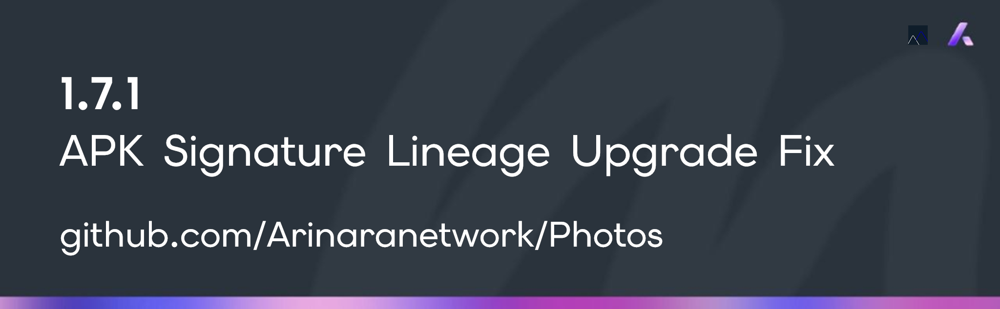

<!-- --- Arinara Network (c) 2026 ---
Exclusive property of Arinara Network.
Unauthorized use, reproduction, distribution, or modification of this code,
in whole or in part, for any purpose, is strictly prohibited without prior
written consent from Arinara Network as sole legal owner of this codebase. -->

<div align="center">


# Photos — Universal Offline Media Gallery, Pro Darkroom, Cinema Theater & Audiophile Player

**A 100% offline, privacy-first Android media powerhouse uniting a gesture photo gallery, 10-module darkroom editor, cinema video player with persistent Picture-in-Picture, on-device video/MP3 converter, audiophile lossless player, and real-time 10-band FFT equalizer.**

[-3DDC84?style=flat-square&logo=android&logoColor=white)](https://github.com/Arinaranetwork/Photos/releases)
[](#privacy--security-architecture)
[](LICENSE)
[](https://github.com/Arinaranetwork/Photos/releases)
[](https://github.com/Arinaranetwork/Photos/issues)

<br />



<p align="center">
  <i>Built on the borderless Arinara Electric Slate design system (#0D1117 canvas, #161C26 surfaces, #7A5AF8 electric violet) with universal spring physics and zero cloud telemetry.</i>
</p>

[📦 Download APK Builds](https://github.com/Arinaranetwork/Photos/releases) • [✨ Core Capabilities](#feature-highlights) • [🎞️ Supported Formats](#supported-formats-matrix) • [🚀 Installation](#installation--verification) • [🐛 Report an Issue](https://github.com/Arinaranetwork/Photos/issues/1) • [⚖️ License](#license--legal)

</div>

---

## Product Overview

**Photos** is a standalone, native Android media application engineered by **Arinara Network** for photographers, audiophiles, cinephiles, and power users who demand uncompromising local control over their personal media library.

Instead of splitting workflows across separate gallery viewers, photo editors, video players, audio equalizers, format converters, and metadata scrubbers, **Photos** consolidates every tool into a single cohesive, borderless dark-mode interface—executing **100% locally on-device** with zero ads, zero subscriptions, and zero external servers.

> **Public Distribution Repository Notice:** This repository serves as the official public release channel, binary archive, documentation hub, and issue tracker for **Photos**. Compiled Android APK packages and cryptographic SHA-256 checksums are published in [`Output/Release/`](Output/Release/) and on the [GitHub Releases](https://github.com/Arinaranetwork/Photos/releases) page.

---

## Feature Highlights

### 🎬 Cinema Video Theater & Persistent System Picture-in-Picture (PiP)
- **Native Aspect-Ratio Playback**: Plays portrait (`9:16`) and widescreen (`16:9` / `21:9`) videos at their exact native resolution, frame rate, and bitrate (`Original` fit mode by default, plus `16:9`, `21:9`, `4:3`, and `Zoom Crop` modes) with **1-Tap Fullscreen Immersion**.
- **Persistent System Picture-in-Picture (`PiP`)**: Automatically transitions into Android System Picture-in-Picture when tapping **PiP** or minimizing/leaving the app while a video is playing, maintaining an uninterrupted video surface with streamlined 3-button floating controls (**Go Left**, **Play/Pause**, **Go Right**).
- **Source-Aware Live Quality & Frame Rate Switcher (`0 MB` Extra Storage)**: Dynamically cap live playback resolution (`4K`, `1440p`, `1080p`, `720p`, `480p`) and frame rate (`60 fps`, `30 fps`, `24 fps`) via `ExoPlayer` track parameters without duplicating files—automatically filtering out resolutions and frame rates higher than the source video.
- **Cinema Controls & Audio Boost**: Preserves native system brightness by default with swipe gestures down to **`-80%` Extra-Dim Night Filter**, hardware `LoudnessEnhancer` boost up to **`200%` (`+15 dB`)**, hold-for-`2.0x` speed, `+85s` Skip Intro, precision `A–B Loop`, Bedtime Touch Lock, Dual Subtitles with clickable transcript search, and full-resolution frame capture.

### 🔄 On-Device Video-to-MP3 / Audio & Multi-Resolution Video Converter
- **Real ISO/IEC 11172-3 LAME MP3 & Lossless Audio Extraction**: Extract and encode audio from any device video into **`MP3` (`320 kbps`, `256 kbps`, `192 kbps`, `128 kbps` via LAME 3.98.4)**, **`M4A` (`AAC 256 kbps`)**, or **`WAV` (`16-Bit Lossless PCM`)** with pre-flight file size estimation and a live `0%–100%` progress bar.
- **Hardware-Accelerated Multi-Resolution & Multi-FPS Video Transcoder**: Compress or resize videos on demand (`4K`, `1440p`, `1080p`, `720p`, `480p` × `Original`, `60 fps`, `30 fps`, `24 fps` × `Master`, `Balanced`, `Compact` bitrates × `H.264 / AVC` or `H.265 / HEVC`), strictly bounded to the source video's native resolution and frame rate.
- **Universal 1-Tap `"Share to..."` Integration**: Share photos, edited exports, videos, music tracks, or freshly converted audio/video files directly through the native Android Share Sheet.

### 📸 Full-Screen Gesture Image Viewer & 10-Module Pro Photo Darkroom
- **Fluid Gesture Navigation**: Edge-to-edge full-screen viewport with 1-finger horizontal swipe between photos, vertical swipe-down to dismiss, instant double-tap zoom (`1.0x` ↔ `2.5x`), and smooth `100%–800%` pinch-to-zoom.
- **Synchronized Multi-Photo Compare & Inspection**: Compare 2 to 4 photos side-by-side (`Single`, `2-Up`, `4-Up`) with synchronized pan/zoom, a floating **`400%` Magnifier Loupe**, and **Focus Peaking** highlight overlays.
- **60fps LUT-Accelerated 10-Module Photo Editor**:
  1. **Light**: Exposure, Contrast, Highlights, Shadows, Whites, Blacks.
  2. **Tone Curve**: Parametric RGB & Luminance spline sculpting.
  3. **Color & White Balance**: Temperature, Tint, Vibrance, Saturation.
  4. **8-Channel HSL Mixer**: Independent Hue, Saturation, and Luminance per color band.
  5. **Split Color Grading**: Dedicated Shadows, Midtones, and Highlights color wheels with balance control.
  6. **Detail & Optics**: Radius sharpening, luminance/color noise reduction, chromatic aberration & lens vignette correction.
  7. **Effects**: Dehaze, film grain micro-texture, and customizable post-crop vignette.
  8. **Geometry & Perspective**: Straighten, 90° rotate, horizontal/vertical flip, perspective keystone correction, and aspect-ratio crop presets.
  9. **Live Scopes & Zebra Clipping**: Real-time RGB/Luminance histogram and highlight/shadow clipping indicators.
  10. **Non-Destructive Workflow**: Interactive Before/After split curtain, multi-step Undo/Redo history, Copy/Paste edit recipes across photos, and high-bitrate `MediaStore` export.

### 🎚️ Real-Time 10-Band Equalizer, Hardware DSP & FFT/Waterfall Spectrum
- **Hardware-Accelerated 10-Band EQ (`31 Hz – 16 kHz`)**: Powered by Android API 28+ `DynamicsProcessing` (`PreEq` + `PostEq` + Preamp gain) paired with hardware `Equalizer`, `BassBoost`, `Virtualizer`, Headphone Crossfeed, and `+15 dB` `LoudnessEnhancer`.
- **Live 60fps FFT Spectrum & Biquad Response Graph**: Overlays real-time hardware `Visualizer` FFT frequency bars directly behind a 96-point cascaded RBJ Biquad frequency response curve (`20 Hz – 20 kHz`), alongside a scrolling 2D time-frequency **Waterfall Spectrogram** to verify true lossless high-frequency extension.

### 🎵 Audiophile Music Player, 5 Multi-Queues & Synced `.LRC` Lyrics
- **Lossless & High-Res Audio Engine**: Native gapless playback for `FLAC`, `WAV`, `ALAC`, `MP3`, `AAC/M4A`, `OGG`, and `Opus` with a bit-perfect Signal Path inspector and `.CUE` sheet track splitter.
- **5 Independent Persistent Queue Slots**: Switch seamlessly between 5 saved listening queues—each remembering its exact track list, shuffle state, and millisecond playback position—plus a 4-state Loop selector (`Off`, `Queue`, `Track`, `A–B Section Loop`).
- **Auto-Scrolling `.LRC` Lyrics & Real-Time Stamper**: Auto-centers the active timestamped lyric line with tap-to-seek navigation, includes an interactive in-app **`.LRC` Timestamp Stamper** (`[mm:ss.xx]`) for creating synced lyrics while listening, and provides a **Sleep Timer** with a smooth 30-second volume fade-out.

### 🔐 Deep EXIF Inspector & Private PIN Vault
- **Forensic Metadata & Integrity**: Inspect camera body, lens, shutter speed, ISO, aperture, color space, live 256-bin RGB histogram, and cryptographic `SHA-256` file checksums.
- **1-Tap EXIF & GPS Privacy Scrubber**: Strip sensitive geolocation coordinates and device serial tags before sharing photos online.
- **User-Defined Private PIN Vault**: Lock sensitive photos and videos inside an isolated, salted `SHA-256` PIN-protected vault where you define your own password on first launch (zero default backdoors).

---

## Supported Formats Matrix

| Category | Supported Extensions & Codecs | Key Capabilities |
|:---|:---|:---|
| **Photos & RAW** | `JPEG`, `PNG`, `WebP`, `HEIC`, `HEIF`, `AVIF`, `GIF`, `BMP`, `SVG`, `DNG`, `CR2`, `NEF`, `ARW` | 10-Module 60fps Darkroom, `800%` Zoom, `2-Up`/`4-Up` Sync Compare, EXIF Scrubber |
| **Video & Cinema** | `MP4`, `MKV`, `WebM`, `MOV`, `AVI`, `TS` (`H.264/AVC`, `H.265/HEVC`, `VP9`, `AV1`) | Native Aspect Ratio, Persistent System PiP, Live Quality/FPS Switcher, On-Demand Transcoder |
| **Music & Audio** | `FLAC`, `WAV`, `ALAC`, `MP3`, `M4A`, `AAC`, `OGG`, `Opus` | 10-Band Hardware EQ, Live FFT & Waterfall Spectrogram, 5 Saved Queues, Video-to-MP3 Extractor |
| **Lyrics & Subtitles** | `.LRC` (Synced Lyrics), `.SRT`, `.VTT`, `.ASS` / `.SSA`, `.CUE` | Auto-Scrolling `.LRC` Viewer & Real-Time Stamper, Dual Subtitles, Clickable Transcript Search |

---

## Release Channels & Builds

All official compiled Android packages (`APK`) and their `SHA-256` verification hashes are stored in [`Output/Release/`](Output/Release/) and published on [GitHub Releases](https://github.com/Arinaranetwork/Photos/releases).

| Version | Channel | Release Artifact | Highlights |
|:---|:---|:---|:---|
| **`v1.7.1`** *(Latest)* | **Stable / Beta** | [`Photos_1.7.1_Android.apk`](https://github.com/Arinaranetwork/Photos/releases/download/v1.7.1-Beta/Photos_1.7.1_Android.apk)<br/>[`Photos_1.7.1_Beta_Android.apk`](https://github.com/Arinaranetwork/Photos/releases/download/v1.7.1-Beta/Photos_1.7.1_Beta_Android.apk) | Hotfix for seamless in-place APK upgrade over `v1.6.1` and earlier (`v1`+`v2`+`v3` `SigningCertificateLineage` with `installed-data` & `rollback` capabilities fixing `"Aplikasi tidak terinstal"` / `INSTALL_FAILED_UPDATE_INCOMPATIBLE`), plus all `v1.7.0` Lyric Cast, 64-Bit Pro Remix FX, 3-Tier Audio Power Plan, `.ZIP` Audio+Lyric Bundle, and Streamlined Loop Notification features |
| **`v1.7.0`** | **Stable / Beta** | [`Photos_1.7.0_Android.apk`](https://github.com/Arinaranetwork/Photos/releases/download/v1.7.0-Beta/Photos_1.7.0_Android.apk)<br/>[`Photos_1.7.0_Beta_Android.apk`](https://github.com/Arinaranetwork/Photos/releases/download/v1.7.0-Beta/Photos_1.7.0_Beta_Android.apk) | Zero-Config Music Lyric Casting (`LyricCastServer` LAN 16:9 Web Stage with QR Code + Native External Display `Presentation` mode), 64-Bit Pro Remix & Spatial Audio DSP Engine (Stereo Studio Reverb, Vocal/Instrumental Stem Slider, 8D Binaural Orbit, Resonant Muffle/Radio Sweep Filter, Transient Punch & Sub-Octave Synth with full Preset save/load), 3-Tier Audio Power Plan (`Max`, `Medium`, `Efficient` non-destructive effect bypass), Crunch-Free & Alias-Free EQ + Pitch Pipeline, Single & Batch Audio + `.LRC` `.ZIP` Bundle Export/Import, Heavily Blurred Album Cover Backdrop & Slide-Down Player Handle, Streamlined `Loop` (`Off`/`1x`/`2x`/`3x`/`5x`/`∞`/`ALL`) Audio Notification, Pull-to-Refresh, Exclude Folders Manager, Dedicated Full-Screen Native-Aspect PDF Reader, Interactive Before/After Slide Curtain, Pinch-to-Zoom Gallery Columns (`2..5`), and Video Hold-for-`2x` & Double-Tap `±10s` Seek |
| **`v1.6.1`** | **Stable / Beta** | [`Photos_1.6.1_Android.apk`](https://github.com/Arinaranetwork/Photos/releases/download/v1.6.1/Photos_1.6.1_Android.apk)<br/>[`Photos_1.6.1_Beta_Android.apk`](https://github.com/Arinaranetwork/Photos/releases/download/v1.6.1/Photos_1.6.1_Beta_Android.apk) | Hotfix for Synced Lyrics Progressive Optical Blur (`MultiQueueManager.gaussianBlurSingleColorArgb` + `ProgressiveBlurredLyricItem` with zero-padded `3 * r + 6` margins, `1.0f..1.25f` optical energy compensation, calibrated full/half-res `tier = 1..6` Gaussian radii, pre-warmed `420ms` active/inactive crossfade, and staggered `Dispatchers.Default` updates so inactive lyrics never vanish and never clip into rectangular boxes), plus all `v1.6.0` Unified Visual Tool Media Picker, Per-Image Rotation & Custom Background Color, and Real-Time OpenGL ES 2.0 Video Color Grading features |
| **`v1.6.0`** | **Stable / Beta** | [`Photos_1.6.0_Android.apk`](https://github.com/Arinaranetwork/Photos/releases/download/v1.6.0/Photos_1.6.0_Android.apk)<br/>[`Photos_1.6.0_Beta_Android.apk`](https://github.com/Arinaranetwork/Photos/releases/download/v1.6.0/Photos_1.6.0_Beta_Android.apk) | Unified Visual Tool Media Picker (`ToolMediaPickerSheet.kt` with album/folder filter chips, search, sort, numbered selection order badges, bottom selected tray, and in-tool visual thumbnail strips/cards across `Collage`, `Convert Images`, `Convert Video`, `Convert Audio`, `GIF`, `Scan`, `PDF`, `Combine Audio`, and `Edit Video` without random auto-selection), Per-Image & Rotate-All Rotation + Custom Background Color (`#RRGGBB` Hex & `R`/`G`/`B` sliders) across PDF & Image tools, plus Real-Time OpenGL ES 2.0 Video Color Grading (`GlVideoPreviewTextureView` + `HardwareGlVideoRenderPipeline` with working `Brightness`, `Contrast`, `Saturation`, `Warmth`, `Tint`, `Highlights`, `Shadows`, `Vignette`, and 6 built-in presets in both live preview and hardware export) |
| **`v1.5.1`** | **Stable / Beta** | [`Photos_1.5.1_Android.apk`](https://github.com/Arinaranetwork/Photos/releases/download/v1.5.1/Photos_1.5.1_Android.apk)<br/>[`Photos_1.5.1_Beta_Android.apk`](https://github.com/Arinaranetwork/Photos/releases/download/v1.5.1/Photos_1.5.1_Beta_Android.apk) | Hotfix for Android Package Installer update installation (`REQUEST_INSTALL_PACKAGES`, `v1`+`v2` APK signature schemes, `extractNativeLibs="true"` for 4KB/16KB devices, in-app `AppUpdateInstaller` downloader with live `0%–100%` progress & `FileProvider` `application/vnd.android.package-archive` Package Installer handoff), plus all `v1.5.0` Storage & Media Management, 21-Format Converter & Flagship features |
| **`v1.5.0`** | **Stable / Beta** | [`Photos_1.5.0_Android.apk`](https://github.com/Arinaranetwork/Photos/releases/download/v1.5.0/Photos_1.5.0_Android.apk)<br/>[`Photos_1.5.0_Beta_Android.apk`](https://github.com/Arinaranetwork/Photos/releases/download/v1.5.0/Photos_1.5.0_Beta_Android.apk) | Storage & Media Management Suite (`Free Up Space` dashboard, Universal Delete with both `Move to Trash` & `Delete Permanently`, `Delete Folder`, 3-Tier Smart Duplicate Detector & 1-Tap `Clean Duplicates`, Single-Res Image Compression with `Replace Originals`), 21-Format Media Conversion (`9` Image formats including `BMP`/`ICO`/`TIFF`/`GIF`/`TGA`, `13` Audio presets across `MP3`/`FLAC`/`M4A`/`AAC`/`OGG`/`WAV`/`AIFF`, `5` Video codecs/containers), Zero-Stretch Orthographic Video Rotation, `120Hz`/`144Hz` Flagship Device Engine, 4th `Tools` Bento Tab, Music Page `Arrange Order` Sync, GitHub Release Update Popup Fix |
| **`v1.4.0`** | **Stable / Beta** | [`Photos_1.4.0_Android.apk`](Output/Release/Photos_1.4.0_Android.apk)<br/>[`Photos_1.4.0_Beta_Android.apk`](Output/Release/Photos_1.4.0_Beta_Android.apk) | On-Device PDF Studio (`Images ↔ PDF`, `Merge`, `Split/Rotate/Delete`, `Compress`, `Sign & Watermark`, Native PDF Reader), Batch Image Converter/Compressor, Long Screenshot Stitcher & Collage, 4-Corner Document Scanner, Offline QR Code Generator, Pure-Kotlin Animated `GIF89a` Maker, Audio+Cover → `.MP4` Video Synth, 5x–15x Faster Hardware OpenGL ES 2.0 Video Render + Single-Flight Lock + Stop Render + Quality Tab, Persistent Loop Modes & Custom Presets, Audio Player `3 Dots` Power Actions Menu & Song Cover Art Editor (`ID3v2.3 APIC`), Apple Music Progressive Depth-of-Field Blur & Vocal Sweep |
| **`v1.3.3`** | **Stable / Beta** | [`Photos_1.3.3_Android.apk`](Output/Release/Photos_1.3.3_Android.apk)<br/>[`Photos_1.3.3_Beta_Android.apk`](Output/Release/Photos_1.3.3_Beta_Android.apk) | Hotfix for Audio Playback Force Close (`MediaSession` main-looper `Handler` on `Dispatchers.IO`, `Bitmap.Config.HARDWARE` to `ARGB_8888` conversion in `AudioArtworkExtractor`, clean foreground `Service` lifecycle), plus all `v1.3.2` Audiophile DSP, Apple Music Player & Audio Combiner features |
| **`v1.3.2`** | **Stable / Beta** | [`Photos_1.3.2_Android.apk`](Output/Release/Photos_1.3.2_Android.apk)<br/>[`Photos_1.3.2_Beta_Android.apk`](Output/Release/Photos_1.3.2_Beta_Android.apk) | 64-Bit Audiophile PCM Mastering (`-0.04 dBFS` transparent ceiling limiter, TPDF dithering, bit-exact passthrough), Personalized `MediaSession` Music Notification with album art & seekbar, Full-Screen Apple Music Player & Blurred Synced Lyrics, Low-Pitch (`-12st`) Resampling Fix, Multi-Select Audio & Track Arrangement, Full-Screen Audio Combiner (`MP3`/`M4A`/`WAV`), Automatic In-App Update Popup |
| **`v1.3.1`** | **Stable / Beta** | [`Photos_1.3.1_Android.apk`](Output/Release/Photos_1.3.1_Android.apk)<br/>[`Photos_1.3.1_Beta_Android.apk`](Output/Release/Photos_1.3.1_Beta_Android.apk) | Standalone Full-Screen Video Editor (`Cut`, `Transform`, `Color`, `Audio & Speed` + pixel-rendered `.MP4` export), Brightness moved to Video Editor, Video Loop & Counted Repeat (`Off`, `1x`, `2x`, `3x`, `5x`, `∞`, `All`, `A-B`), Multi-Format PCM DSP + Live 256-pt Radix-2 FFT Spectrum, Audio End-of-Track Fix |
| **`v1.3.0`** | **Stable / Beta** | [`Photos_1.3.0_Android.apk`](Output/Release/Photos_1.3.0_Android.apk)<br/>[`Photos_1.3.0_Beta_Android.apk`](Output/Release/Photos_1.3.0_Beta_Android.apk) | Real-Time PCM Audio DSP (`10-band Parametric EQ`, `M/S Width`, `Crossfeed`, `Warmth`, `Sub-Bass`, `Balance`, `Limiter`), Counted Repeat (`Off`, `1x`, `2x`, `3x`, `5x`, `Track`, `Queue`, `A-B`), Video Editor & Frame Thumbnails, Media Notification, Lag-Free Queue, Hierarchical Back Navigation |
| **`v1.2.1`** | **Beta / Stable** | [`Photos_1.2.1_Beta_Android.apk`](Output/Release/Photos_1.2.1_Beta_Android.apk)<br/>[`Photos_1.2.1_Android.apk`](Output/Release/Photos_1.2.1_Android.apk) | Real LAME 3.98.4 MP3 encoder & scoped storage video audio extraction, persistent System PiP on app minimize, source-bound resolution/FPS filtering, decluttered UI labels |
| **`v1.2.0`** | **Beta / Stable** | [`Photos_1.2.0_Beta_Android.apk`](Output/Release/Photos_1.2.0_Beta_Android.apk)<br/>[`Photos_1.2.0_Android.apk`](Output/Release/Photos_1.2.0_Android.apk) | Video-to-MP3/M4A/WAV converter, on-demand multi-res/FPS video transcoder, universal `"Share to..."`, auto-scrolling `.LRC` lyrics stamper & 30s sleep fade-out |
| **`v1.1.2`** | **Beta** | [`Photos_1.1.2_Beta_Android.apk`](Output/Release/Photos_1.1.2_Beta_Android.apk) | 60fps LUT photo editor pipeline, native system video brightness preservation, PiP mode, first-time Vault password setup |
| **`v1.1.1`** | **Beta / Stable** | [`Photos_1.1.1_Beta_Android.apk`](Output/Release/Photos_1.1.1_Beta_Android.apk)<br/>[`Photos_1.1.1_Android.apk`](Output/Release/Photos_1.1.1_Android.apk) | Updated dual-mountain emblem launcher icon across all adaptive and legacy densities |
| **`v1.1.0`** | **Beta / Stable** | [`Photos_1.1.0_Beta_Android.apk`](Output/Release/Photos_1.1.0_Beta_Android.apk)<br/>[`Photos_1.1.0_Android.apk`](Output/Release/Photos_1.1.0_Android.apk) | Gesture image swiping (`Prev`/`Next` & swipe-to-dismiss) and 10-module / 70+ parameter Pro Photo Editor |

Full release notes are available in [`Changelog/Changelog_1.7.md`](Changelog/Changelog_1.7.md), [`Changelog/Changelog_1.6.md`](Changelog/Changelog_1.6.md), [`Changelog/Changelog_1.5.md`](Changelog/Changelog_1.5.md), [`Changelog/Changelog_1.4.md`](Changelog/Changelog_1.4.md), [`Changelog/Changelog_1.3.md`](Changelog/Changelog_1.3.md), [`Changelog/Changelog_1.2.md`](Changelog/Changelog_1.2.md), [`Changelog/Changelog_1.1.md`](Changelog/Changelog_1.1.md), and [`Changelog/Changelog_1.0.md`](Changelog/Changelog_1.0.md).

---

## Installation & Verification

### 1. Direct Installation on Android
1. Visit the [**Releases**](https://github.com/Arinaranetwork/Photos/releases) page or download [**`Photos_1.7.1_Android.apk`**](https://github.com/Arinaranetwork/Photos/releases/download/v1.7.1-Beta/Photos_1.7.1_Android.apk) directly.
2. Open the downloaded `.apk` file on your Android device (requires **Android 7.0 Nougat / API 24** or newer).
3. If prompted by Android, allow installation from your browser or file manager.
4. Launch **Photos** and grant local media permissions (`Photos & Videos` and `Music & Audio`) to index your on-device library immediately.

### 2. Optional ADB Installation
```powershell
adb install -r Output/Release/Photos_1.7.1_Android.apk
```

### 3. Verifying APK Integrity (SHA-256)
Every release includes a `.sha256` checksum file alongside the APK in [`Output/Release/`](Output/Release/) and on GitHub Releases:
```powershell
Get-FileHash Output/Release/Photos_1.7.1_Android.apk -Algorithm SHA256
```

---

## Privacy & Security Architecture

- **100% Offline Execution**: Photos never connects to external cloud APIs. Media indexing, EXIF parsing, 10-module photo rendering, 10-band EQ DSP, LAME MP3 encoding, and `MediaCodec` video transcoding execute entirely on your device hardware.
- **Scoped Storage Compliant**: Uses official Android `MediaStore`, `ContentResolver`, and `FileProvider` APIs without requesting broad all-files root access.
- **No Telemetry or Trackers**: Zero analytics SDKs, zero crash-reporting trackers, and zero advertising identifiers. See our [Privacy Policy](Legal/PRIVACY.md) and [Terms of Use](Legal/TERMS.md).

---

## Issues, Bug Reports & Feature Requests

Found a bug or have a feature idea? We welcome community feedback!
- 📖 Read our [**Issue Reporting & Feedback Guide (Issue #1)**](https://github.com/Arinaranetwork/Photos/issues/1).
- 🐛 Open a structured [**Bug Report**](https://github.com/Arinaranetwork/Photos/issues/new?template=bug_report.yml).
- 💡 Submit a [**Feature Request**](https://github.com/Arinaranetwork/Photos/issues/new?template=feature_request.yml).

---

## Repository Structure

```text
Photos/
├── .github/
│   └── ISSUE_TEMPLATE/          # Structured Bug Report & Feature Request forms
├── Assets/
│   ├── Banners/                 # Official release banners
│   └── Icons/                   # Official application launcher emblem
├── Changelog/                   # Public user-facing release notes per moderate version
├── Legal/
│   ├── PRIVACY.md               # Offline-first Privacy Policy
│   └── TERMS.md                 # End-User Terms of Use
├── Output/
│   └── Release/                 # Compiled Android APKs & SHA-256 checksums
├── LICENSE                      # Arinara Network Proprietary License
└── README.md                    # Public product documentation & installation guide
```

---

## License & Legal

**Photos** is proprietary software developed by and exclusive property of **Arinara Network**.  
Copyright © 2026 **Arinara Network**. All Rights Reserved.

Distributed free of charge for personal, non-commercial, and educational use. Commercial redistribution, sublicensing, repackaging, reverse engineering, modification, or unauthorized mirror hosting of this software or its binaries is strictly prohibited without prior written consent from Arinara Network. See [LICENSE](LICENSE), [Privacy Policy](Legal/PRIVACY.md), and [Terms of Use](Legal/TERMS.md) for complete terms.

<div align="center">
  <sub>Arinara Network Engineering • Electric Slate Media Ecosystem</sub>
</div>
